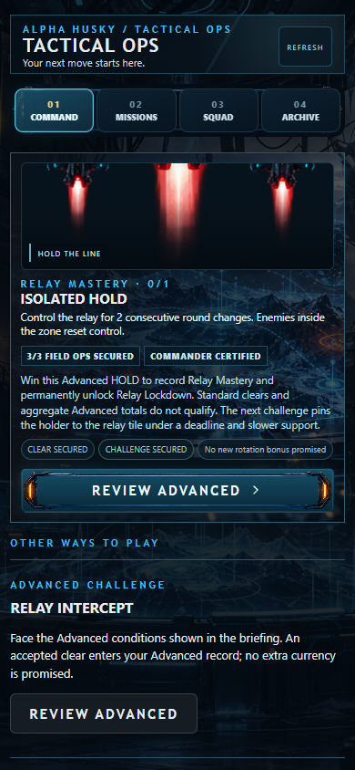
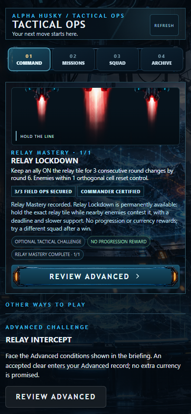

# DEPTH 01 — Meaningful Mastery Path

Baseline: `a24dc6a9aae39dbb700a205f5ebfb9bdabe37173`, merged PR #212. One permanent accomplishment, one optional challenge, existing COMMAND / Brief / Results. Implementation candidate; release HOLD pending the manual gates below.

## Player loop

1. At Commander Rank 3, COMMAND recommends the current **Advanced HOLD**, with **Relay Mastery 0/1**, the exact requirement and its permanent unlock. Accepted runs and unfinished story retain PR #212 priority. The two alternating three-mission rotations each contain one qualifying HOLD.
2. Win Advanced Relay Hold **or** Advanced Isolated Hold. The server records **Relay Mastery 1/1** inside existing Field Ops progression. A pre-existing mission-specific `advancedClearCount > 0` qualifies. Generic career totals, Standard clears and client session observations do not.
3. Results confirm the unlock and offer **Relay Lockdown**, even when Relay Hold is absent from rotation. Reload preserves ownership. No additional framework, rank, skill point, currency or tree is introduced.
4. Lockdown requires one ally **on the exact relay tile** for three consecutive round changes by round 6. Enemies within one orthogonal cell still contest and reset progress. One HOUND arrives in round 2; support recharges one personal turn slower. Enemy HP/stats are unchanged.
5. Results record the optional attempt. Victory offers another squad/holder; defeat preserves the unlock and explains the position/deadline requirement. The path stays honestly complete at 1/1. Lockdown grants no currency, Commander, Growth, Pack Mastery, career or base rotation rewards.

| COMMAND, locked | COMMAND, unlocked |
| --- | --- |
|  |  |

[Exact brief](evidence/depth01/brief.png) · [Battle marker](evidence/depth01/battle.png) · [Confirmed Results](evidence/depth01/results.png)

## Tactical proof

Focused real-engine matrix: **96 battles, 66 wins / 30 defeats**, all three legal lineups, base/developed stat profiles, two builds, four policies, both 8×5 and accepted 10×7. All resolve. Twelve total purchased skill ranks; no impossible 18-point account fixture.

Concrete 10×7 examples with unchanged base combat stats:

| Legal squad / plan | Observed result |
| --- | --- |
| ALPHA + CNC + SHADOW, pursue/control with sustain available | Win round 5, 9 moves, 9 attacks |
| ALPHA + CNC + PET, mobile pursuit | Win round 4, 6 moves, 8 attacks |
| ALPHA + CNC + PET, DISRUPTOR control | Win round 6 with 2 actual intent interrupts |
| Evasive policy that abandons the anchor | Deadline defeats; cancellations alone do not satisfy HOLD |

The same adjacent ally occupancy satisfies current Advanced HOLD but cannot advance Lockdown. New `holderRadius: 0` is optional; old HOLD retains its radius and behavior. The holder must weigh evasion against resetting the objective while companions remove contesters. This is a positioning decision beyond existing Advanced directive stacking.

Mastery before/after changes PET's actual reached positions through PATHFINDER. Growth before/after changes the tested pursuit from a round-4 victory to deadline defeat in round 7. These are scripted engine observations, not human balance or retention claims.

## Persistence and trust

The existing strict user transaction, accepted run slot, revision checks and request receipts own all writes. Challenge contexts use `reportVersion: 4` plus `masteryChallenge: relay-lockdown-v1`; the existing VNext grid contract stays unchanged. Version 1–3 accepted runs are preserved. A variant cannot overwrite a different accepted Field run. Resume retains its original cycle, fixed pressure, squad, Growth and Mastery; combat restarts at round 1 as before. The completion report must echo the accepted variant. Duplicate, stale, downgraded and impossible timing reports fail safely.

Local HTTP proof uses real aiohttp routes, temporary strict JSON files and a synthetic identity. Each accepted run is passed to the real frontend engine with its exact server-issued profile, Growth, Mastery, squad and conditions; its real report is then settled over HTTP. Advanced HOLD wins round 7 under attrition, unlocks, reloads, and Lockdown wins round 5. Duplicate request replay and changed-payload conflict are checked. [Sanitized evidence](evidence/depth01/persistence.json).

**Existing trust boundary remains client combat / server progression.** The server validates accepted context and report consistency; it does not independently replay movement, tile occupancy or combat actions. `SERVER_ADVANCED_HOLD` means a server-recorded mission result, not an anti-cheat action certification.

Private backend: only `tactical_field_ops.py` and `tactical_ops_foundation.py` change; a focused test stays private. [Baseline/candidate SHA-256 manifest](evidence/depth01/private-backend-manifest.json). No backend source is published here. The local complete package is `K:\ALPHA_WORKSPACE\DEPTH01_PRIVATE`.

## Validation and authority

- Six focused private backend tests PASS, including real HTTP + exact accepted engine snapshots; 34 existing Foundation/Field persistence tests PASS.
- New state/transport/goal tests PASS; existing purpose, objective AI, run-contract wire, S3 consequences/power proof and G1 transaction regressions PASS.
- **52** portrait UI cases PASS across 320, 360, 390 and 430 CSS px: fresh, locked, unlocked, prior-cycle accepted, completed, failed, old backend; unique recommendations, actual navigation, replay outside rotation and both battle grids.
- Canonical IIFE/cache: `3.6.12-depth01`. Dedicated hosted workflow runs contracts, real engine, mobile cases and deterministic bundle parity; private backend testing remains local.
- Unchanged broader regression evidence remains in merged PR #212. Physical-device verification is not inferred from Chromium.

All four original design authorities were read from the owner-supplied `PROJECT_CHECKPOINTS/ALPHA_TACTICAL_OPS_ORIGINAL_BLUEPRINTS.zip`:

| Authority | DEPTH 01 mapping |
| --- | --- |
| Meaningful Gameplay Blueprint V1 S2 | Exact tile versus contested area; three legal squads, base/developed profiles; actual successful interrupts and failed evasion; no HP inflation. Unchanged twelve-mission proof is reused from PR #212. |
| Meaningful Gameplay Blueprint V1 S3 | Existing Mastery/Growth before/after proof; one persistent unlock with receipt/reload evidence; truthful no-reward practice and one next action. No invented world consequence. |
| Evergreen Architecture V1 §§28–30 | Existing Pack progression matters in a following encounter; one economical config variant, one optional HOLD parameter; no independent framework. |
| Depth & Progression Working Note §§4–6, 9–10 | Real companion trade-offs, existing saved upgrades survive sessions and change next-run play. No new trees, currencies or token dependency. |
| Campaign & Progression Architecture V1 §§7, 9, 13–16, 21 | Configured content over current core; one save source; once-only unlock; defeat preserves progress; existing War Table / Brief / Results, portrait-first. |

The related October long-term and campaign blueprints and PR #212 contracts were also reviewed. The Working Note's historical phase-start/device gates are not asserted complete here; the current explicit DEPTH 01 request authorizes this focused local implementation, while physical-device/production acceptance remains open.

## Manual release gates — HOLD

1. Owner confirms the two VPS baseline hashes and runtime destination against the private manifest; review/deploy the private backend and paired frontend manually. No automatic merge, VPS access or deployment occurred.
2. Complete S2/S3 human comprehension and real-device acceptance; the exact design-source reconciliation is complete.
3. Physical S26 Ultra Telegram / standalone Android and iPhone: locked → unlock → minimize/reopen → battle → save/reconnect, expired rotation, touch/scroll/safe areas, failure and offline save retry. Check both old accepted 8×5 and new 10×7 runs.
4. A developed Rank 3 player can explain current objective, qualifying proof, permanent option, exact-tile difference and the next honest action without coaching. No claim of long-term retention.
5. Do not roll either client or backend back to a version that cannot read active v4 runs. Finish/drain those runs with this pair first; retain user data and receipts. See private handoff for backups, order, verification and rollback constraints.
