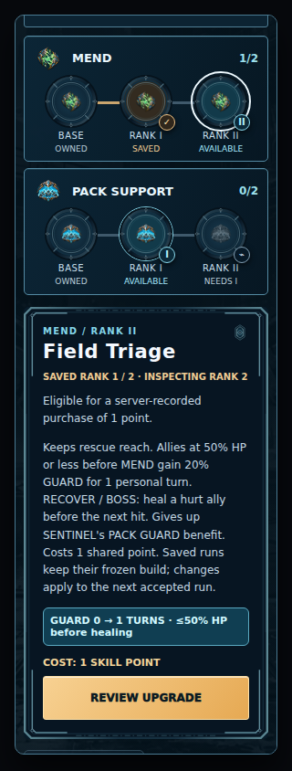
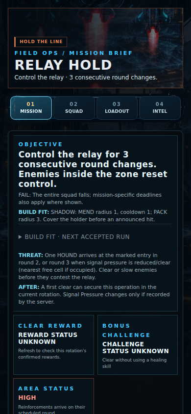
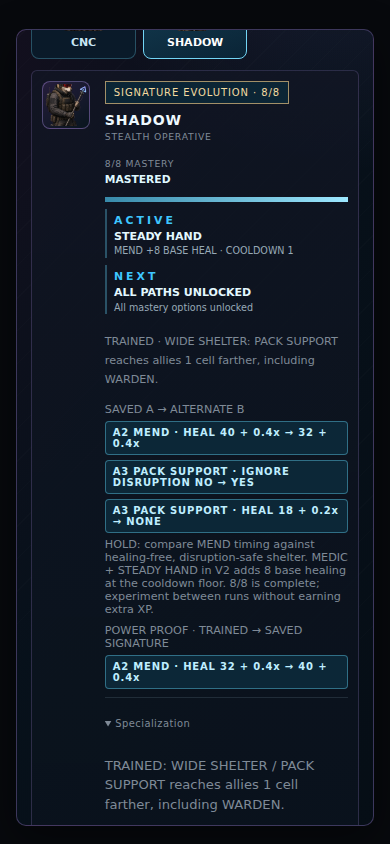
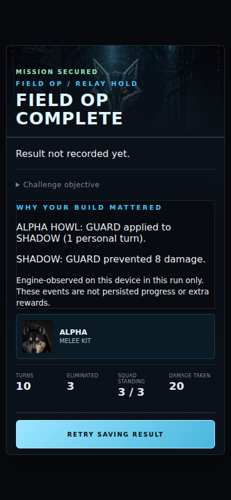

# G1 — Meaningful Builds & Fieldcraft

Implementation on public main `5c6133360927f0c306540a2cb89bca8b3a0aad45`.
One branch: `feat/g1-meaningful-builds-fieldcraft`. Draft review only.

**Public implementation and fixture validation: implemented. Production acceptance: HOLD.**
Version-2 combat requires a separately reviewed private server contract and owner balance/device QA. This branch does not upgrade live accounts, flip Atlas/VNext flags, deploy, or change the VPS. G2–G4 are excluded.

## Mechanics and compatibility

The initial matrix found 39 no-effect purchases in 432 compositions: 36 doctrine/rank pairs × three sidegrade states × Mastery 0/3/8 A/B. All were MEND cooldown floors. Other ranks have a real measured delta; no unrelated numeric buffs were added.

| Composition | Version 1 (preserved) | Version 2 candidate |
| --- | --- | --- |
| MEND R1 | Cooldown −1; often saturated | Single-target range 3→4; RESTORER radius 1→2; no rank cooldown discount |
| MEND R2 | Cooldown −2; saturated at floor 1 | Keeps R1 reach; adds 20% GUARD for one personal turn only to recipients at ≤50% HP **before** healing |
| MEDIC + STEADY HAND | Both reductions hit floor 1 | Cooldown remains 1; STEADY HAND adds 8 base healing (32 + 0.4×ATK → 40 + 0.4×ATK) |
| SENTINEL + WARDEN | Doctrine GUARD omitted because WARDEN already has GUARD | Existing 50% WARDEN GUARD lasts one extra personal turn |
| Authored GUARD value | Engine always halves damage, even for value 0.2 | V2 casts use authored reduction, capped at 50%; weaker refreshes cannot replace stronger reduction |

This is an explicit balance proposal inside executable code. V2 R1 exchanges its old cooldown discount for rescue reach; authored VANGUARD/SENTINEL GUARD is 20%, while WARDEN remains 50%. These changes are **not** silently applied to version-1 records/runs. They require owner review before private rollout.

`GrowthSnapshot.version` accepts 1 or 2. A validated snapshot supplies the runtime hero `rulesVersion`; nested runtime fields cannot override its version. Existing version-1 snapshots, rank IDs, shared points, claimed clears, doctrine ownership and `respecUsed` retain their interpretation. Unknown versions fail closed. Battle creation copies ranks/version, so later account edits never alter an accepted battle.

There is no client-side migration, refund, respec consumption or capability flag inferred from local storage. Existing version-1 MEND no-ops remain purchase-disabled. **New V2 mechanics only execute with a version-2 account/run supplied by the server.**

## Player-facing behavior

Atlas and classic Skillbook preview the actual composed sidegrade + Mastery + doctrine, not a base skill that the player is not using. Each review explains real deltas, the mission situation, the sacrificed doctrine, shared-point cost, one-time respec and next-accepted-run scope. No-op checks also run at the store action boundary.

Pack Mastery shows the retained trained passive and numeric saved A/B→alternate comparison for the same ranks/doctrine/sidegrade. The MEDIC floor displays its healing benefit honestly. Field, operation and chapter attempts lock companion A/B in both UI and store; stale Mastery responses cannot roll back a newer revision. Progress remains capped at 8/8.

The existing mission brief exposes one immediate BUILD FIT line and expandable other-role examples derived from the actual composed skills and objective. No win percentage, automatic loadout mutation or invented reward is generated. Intent cancellation correctly requires the DISRUPTOR **doctrine**, an in-range legal PRESSURE and an interruptible locked intent; the legacy sidegrade is optional.

The current-session journal records only successful engine events: extra-rank reach actually admitted a target, positive healing, applied status, actual GUARD damage prevented, a scheduler-confirmed interrupt, or a successful PET relay recovery with measured distance. The result panel matches run + mission, works before a result save and after defeat, and states that the events are device-session observations rather than persisted evidence/rewards. An empty/stale journal shows “No build-specific effect observed in this encounter.” SHADOW HOLD evidence now recognizes the engine's actual `u03-pack*` source IDs as well as legacy source labels.

## Validation

- 432 measured compositions: **39 legacy no-ops, zero V2 no-ops**. Each V2 composition also executes its real ability with standard and Disrupted Support rules: **864 successful engine casts**, with actual cooldown assertions.
- Focused engine fixtures: R1 target admission, RESTORER AoE radius, R2 pre-heal threshold, positive healing, 20% mitigation, preservation of stronger GUARD, no false effects at full HP, illegal-action rejection, stale-run proof rejection, immutable run copies, invalid version/point accounting rejection.
- Real store + public host parser with mocked transport: pending double-tap suppression, receipt/reload, stale/network failure, missing progression, one-time reset, chapter Mastery lock and unchanged 8/8. Mock idempotency tests fixture behavior, **not** the private server's implementation.
- All 51 available Tactical Node regression scripts passed (see [QA results](qa/g1/regression-results.json)); existing 12-mission legacy simulation remains 136/136 wins.
- G1 expanded simulation: **816 completed battles, 774 wins, 42 losses, zero unresolved/policy stalls, 74 actual intent interrupts**. Three builds × two profiles × two controller policies × standard/advanced × eligible squads across 12 missions. Both tiers have HOLD and INTERCEPT victories for every build. Courier losses remain in the CSV, not discarded.
- Same fresh ALPHA+CNC+SHADOW / control policy: RELAY INTERCEPT wins in 7 rounds with hold-line, 5 with cut-courier, 6 with break-signal. RELAY HOLD: hold-line uses 5 moves/11 attacks versus cut-courier's 12 moves/13 attacks (both nine rounds). These are deterministic controller results, not human fun/retention claims.
- Chromium 153 emulation: Atlas P3's 17 scenario groups plus 20 G1 cases at 320/360/390/430 px. Includes navigation, costs/tradeoffs, V2 ranks, exact Mastery comparison, active-run lock, actual brief/result components, stale proof, no horizontal overflow, prior Atlas 44px controls, missing art, safe-area/short-dialog and mocked save-failure/cancel/reopen cases.
- Canonical `npm run build:tactical-ops`, JS syntax and bundle/cache parity required. Version: `3.6.0-g1-fieldcraft`. No gameplay feature is globally enabled by the version/cache bump.

Commands:

```sh
npm install --no-audit --no-fund
npm run verify:tactical-ops:g1
node tools/simulate_tactical_s2_full_combat.mjs
npm run build:tactical-ops
node --check js/tactical_ops.js
# Browser fixtures require Playwright and Chromium; environment overrides are supported.
npm run verify:tactical-ops:g1:browser
```

The older package aggregate references missing legacy tools on main; the new G1 commands and the actual available `tools/verify_tactical*.mjs` files are the executed checks. CI uploads full matrices/logs/screenshots. Committed [rank matrix](qa/g1/rank-matrix.json), [simulation summary](qa/g1/simulation-summary.json) and [all simulation rows](qa/g1/simulation-runs.csv) are reproducible.

## Screenshots — mocked account, real UI






## Private integration handoff — HOLD, no private source included

The current public contract used `playerGrowth.version: 1`; it has no safe client-only marker distinguishing an old accepted run from a new one. Reinterpreting that version globally would violate the freeze requirement. Therefore:

1. Review/approve the table above and mirror its effective-rank validation privately. No private implementation is present here.
2. Preserve all saved ranks, points, claimed clears and one-time-reset flags. Versioning must not mint points, clear ownership or consume a reset. Select a deliberate server-owned eligibility/release policy; the client must not opt accounts in.
3. Return account `playerGrowth.version: 2` only when its purchase validator supports these rules. Existing request endpoints/bodies remain unchanged: request ID + expected Foundation revision + hero/discipline/skill/rank, or respec.
4. Freeze the selected version, ranks and revision into every new accepted run's `playerGrowth`. Retain version 1 verbatim for already accepted runs and legacy records. A V2 account resuming a V1 run must still execute V1 mechanics. New accepted runs must agree with account-purchase preview.
5. Preserve transactional revision checks, idempotent receipts and field/operation/chapter companion locks. Validate reload, reconnect, duplicate requests and second-device concurrency against the real private service.
6. Keep client combat observations untrusted. No trial certification, chapter proof or extra award is requested by this PR.

## Acceptance gates still open

- Private server version-2 validation, ownership-preserving transition and new-run emission: **HOLD / not changed or verified**.
- Actual server purchase/reload, stale/duplicate request, respec and cross-device semantics: **not verified**; fixture checks are not a substitute.
- S26 Ultra Telegram + standalone Android and iPhone 13 Safari/Telegram: **not tested physically**. Chromium emulation is not iOS validation.
- Owner balance acceptance and both HOLD/INTERCEPT playthroughs explaining the consequential build choice: **not verified**.
- GitHub CI: inspect the Draft PR's actual check conclusions; local results do not certify hosted CI.

Before any rollout, test on a staging fixture account with existing ranks and a version-1 active run: reload/resume without stat changes; cancel a purchase; accept V2 R1/R2 after server approval; inspect STEADY HAND vs SILENT SHELTER; play HOLD and INTERCEPT; trigger a real announced interrupt; verify result-save failure keeps only session evidence; reconnect/reload and verify canonical ownership. Do not consume the owner's real one-time respec merely for QA.

**Not merged, deployed or globally enabled. G1 production acceptance remains HOLD until the above gates pass.**
